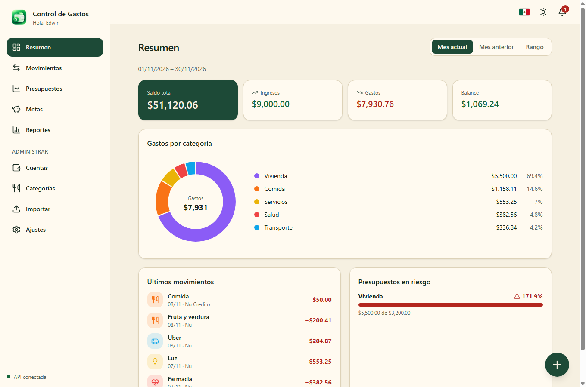
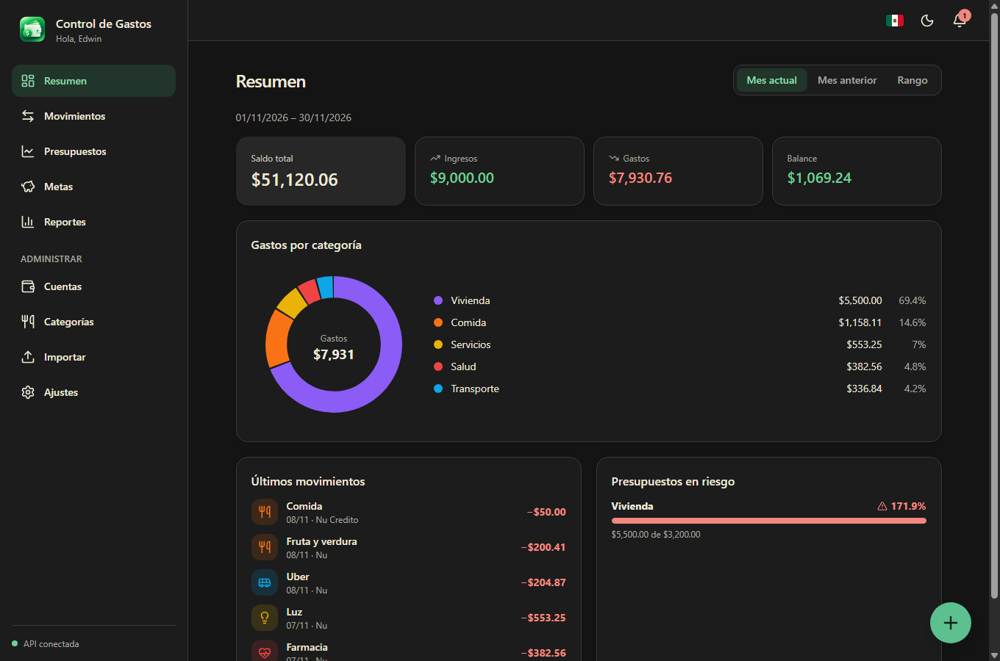
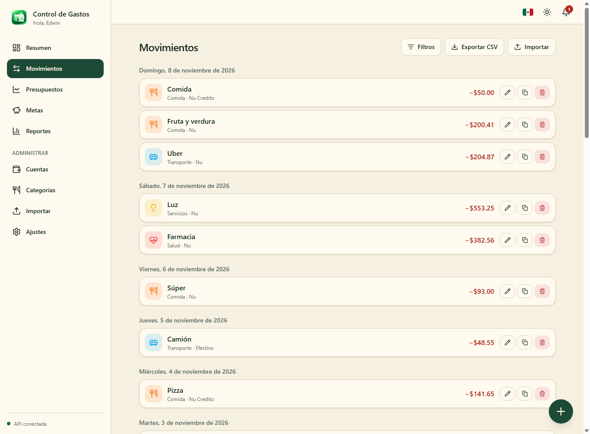
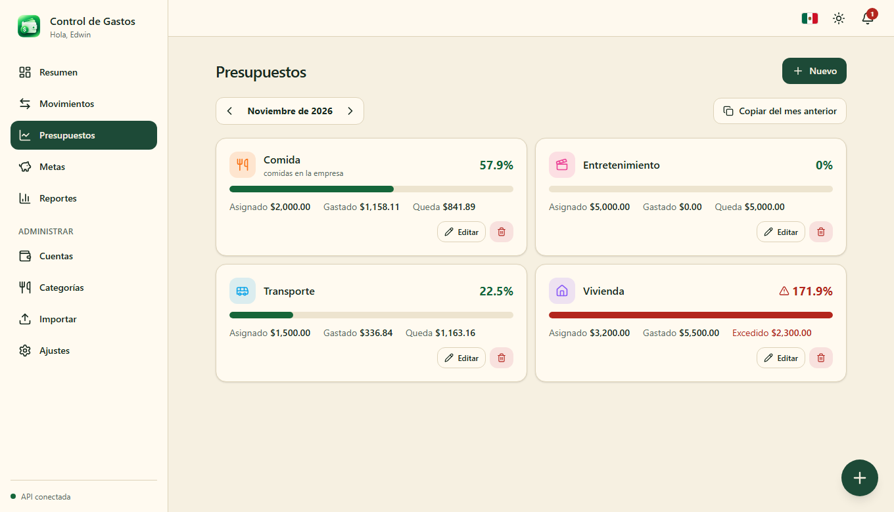
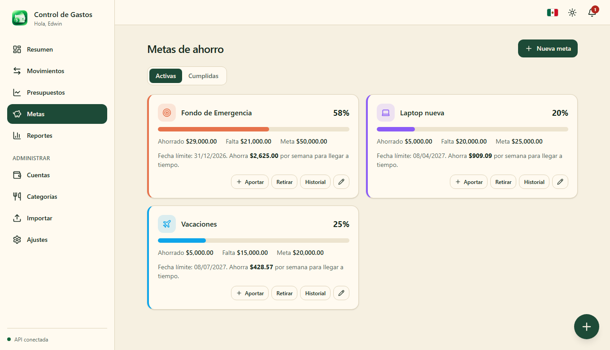
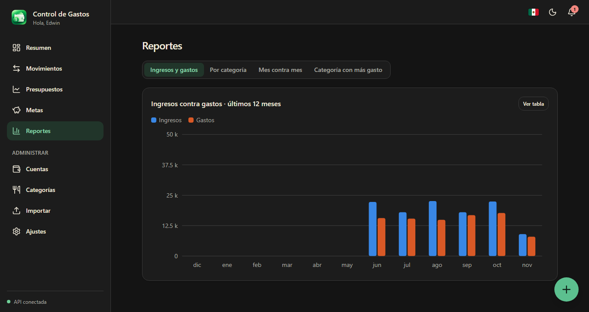
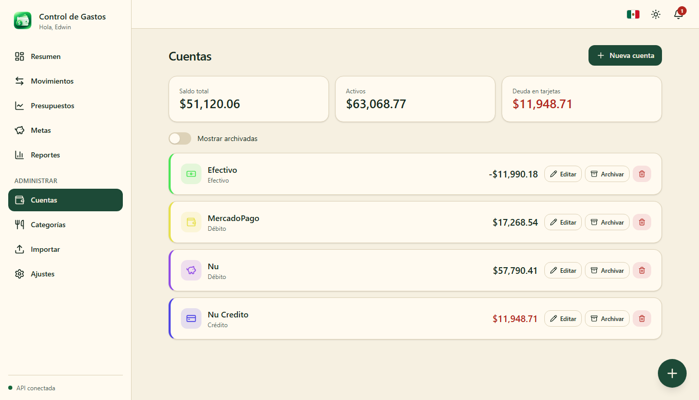
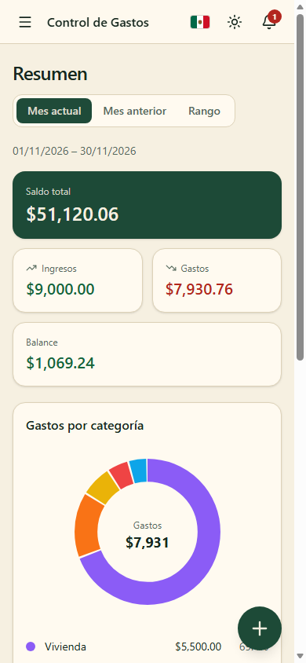
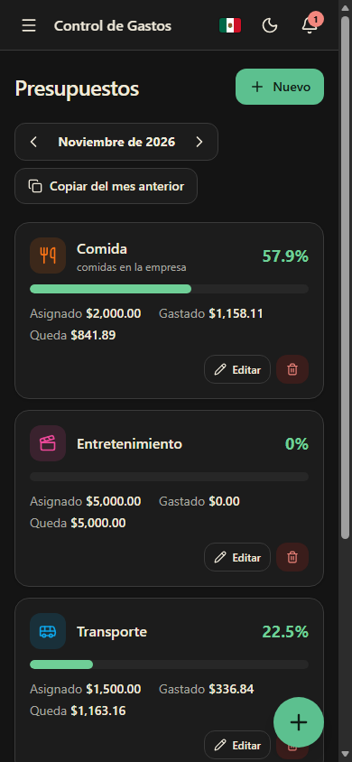

# Control de Gastos

Aplicación web para llevar el control de tus finanzas personales: cuentas, movimientos, presupuestos, metas de ahorro y reportes. Es de un solo usuario, maneja una moneda principal configurable (MXN por defecto), es responsive (mobile first), tiene modo claro y oscuro y está disponible en español e inglés.

| Escritorio, modo claro | Escritorio, modo oscuro |
| --- | --- |
|  |  |

## Funcionalidades

- **Cuentas**: efectivo, débito, crédito, ahorro e inversión. El saldo se calcula a partir del saldo inicial y los movimientos (en tarjetas de crédito el saldo es la deuda). Archivar, restaurar y eliminar; el nombre es único.
- **Categorías**: de gasto y de ingreso, con color, ícono (con buscador) y comentario descriptivo. Vienen 12 predeterminadas.
- **Movimientos**: gastos, ingresos y transferencias entre cuentas, con filtros, duplicado rápido, aporte a una meta desde el mismo formulario y botón flotante para registrar desde cualquier pantalla.
- **Presupuestos**: mensuales por categoría o globales, con semáforo (verde < 75 %, amarillo 75–100 %, rojo > 100 %) y copia del mes anterior.
- **Metas de ahorro**: aportes y retiros con historial, fecha límite y cuánto ahorrar por semana para llegar a tiempo.
- **Resumen**: saldo total, ingresos, gastos, balance, gastos por categoría, últimos movimientos y presupuestos en riesgo, por mes actual, mes anterior o rango.
- **Reportes**: ingresos contra gastos, evolución de una categoría, comparativo mes contra mes y categoría con más gasto de cada mes (en tabla o gráfica).
- **Importar y exportar**: exportación a CSV con los filtros aplicados e importación de CSV con vista previa, mapeo de columnas y detección de duplicados.
- **Notificaciones**: avisos al llegar al 75 % de un presupuesto, al rebasarlo y recordatorio diario para registrar gastos.
- **Ajustes**: nombre, moneda, zona horaria, día de inicio del mes financiero, recordatorio, tema e idioma.

## Capturas

<table>
  <tr>
    <td><b>Movimientos</b><br></td>
    <td><b>Presupuestos</b><br></td>
  </tr>
  <tr>
    <td><b>Metas de ahorro</b><br></td>
    <td><b>Reportes (modo oscuro)</b><br></td>
  </tr>
  <tr>
    <td colspan="2"><b>Cuentas</b><br></td>
  </tr>
</table>

### Móvil

<p>
  
  &nbsp;
  
</p>

## Tecnologías

| Capa | Tecnología |
| --- | --- |
| Frontend | Angular 21 (componentes standalone y signals), Tailwind CSS v4, ngx-translate, íconos Lucide, gráficas SVG propias |
| Backend | .NET 10, ASP.NET Core Web API, Entity Framework Core, documentación con Scalar |
| Base de datos | PostgreSQL 17 (Database First: el esquema vive en scripts SQL) |

### Arquitectura del backend (Clean Architecture)

```
Domain  →  Application  →  Infrastructure  →  Api
entidades  servicios, DTOs,  EF Core / Npgsql,   controladores,
           interfaces de     repositorios        manejo de errores
           repositorio
```

Las reglas de negocio (`ReglaNegocioException`) responden 409; las validaciones de datos, 400.

## Estructura

```
backend/src/       API en .NET (Domain, Application, Infrastructure, Api)
database/          Scripts SQL del esquema (001…008) y datos de ejemplo en demo/
frontend/          Aplicación Angular
docs/capturas/     Capturas usadas en este README
```

## Cómo ejecutarlo

### Requisitos

- .NET SDK 10
- Node.js y npm
- PostgreSQL 17

### 1. Base de datos

Crea la base `control_gastos` y ejecuta los scripts en orden (ver [`database/README.md`](database/README.md)):

```bash
psql -h localhost -p 5433 -U postgres -d control_gastos -f database/001_cuentas.sql
# … hasta 008_categorias_comentario.sql
```

### 2. API

La cadena de conexión (sin contraseña) está en `appsettings.Development.json`. La contraseña se guarda en *user secrets*:

```bash
dotnet user-secrets set "ConnectionStrings:DefaultConnection" "Host=localhost;Port=5433;Database=control_gastos;Username=postgres;Password=TU_PASSWORD" --project backend/src/ControlGastos.Api

cd backend/src/ControlGastos.Api
dotnet run --launch-profile http
```

La API queda en `http://localhost:5007` y la documentación interactiva en `http://localhost:5007/scalar/v1`. CORS solo permite `http://localhost:4200`.

### 3. Frontend

```bash
cd frontend
npm install --legacy-peer-deps
npm start
```

Abre `http://localhost:4200`. La URL de la API se configura en `frontend/src/environments/`.

### Datos de ejemplo (opcional)

Para ver la app con información, carga movimientos, presupuestos y metas de ejemplo (usa cuentas llamadas `Nu`, `MercadoPago`, `Nu Credito` y `Efectivo`):

```bash
psql -h localhost -p 5433 -U postgres -d control_gastos -f database/demo/seed_demo.sql
```

Para borrarlos sin tocar tus datos: `database/demo/quitar_demo.sql`.

## Idiomas

Los textos están en `frontend/public/i18n/es.json` y `en.json`. En español la clave es el propio texto, así que `es.json` solo guarda los textos con parámetros; los textos nuevos hay que agregarlos a `en.json`. Los mensajes de error que genera la API siguen en español.

## Cambios en el esquema

El esquema se cambia primero en SQL (nuevo script numerado) y después se regeneran los modelos:

```bash
cd backend/src
dotnet ef dbcontext scaffold "<cadena de conexión>" Npgsql.EntityFrameworkCore.PostgreSQL \
  -p ControlGastos.Infrastructure -s ControlGastos.Api --context AppDbContext \
  --context-dir Persistence --output-dir Persistence/Entities --no-onconfiguring --force
```

Detén la API antes de regenerar.
